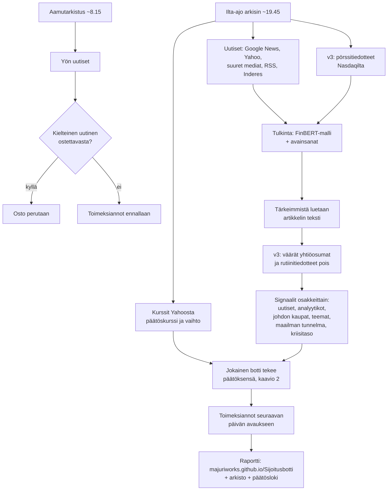
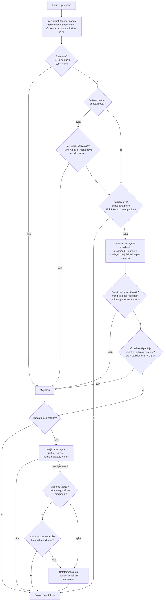

# Miten botti toimii

Kaaviot kuvaavat uusimman version (v3) toimintaa. Vanhat versiot toimivat samoin, mutta niistä
puuttuvat v3:n lisäykset (merkitty **v3**). Muutokset: [MUUTOKSET.md](MUUTOKSET.md).

## 1. Päivän kulku

Pilvi (GitHub Actions) ajaa botin arkisin noin klo 19.45 ja tekee aamutarkistuksen klo 8.15.
Ajastetut ajot alkavat usein 30–60 minuuttia myöhässä.

## 2. Yhden botin päätös (joka kauppapäivä)

## Botit

| Botti | Tarkistaa | Pitoaika | Valitsee |
|---|---|---|---|
| **Lyhyt** | joka päivä | päivistä viikkoihin | tuore myönteinen uutinen + nouseva kurssi |
| **Pitkä** | kerran kuussa | kuukausista vuosiin | vuoden tasainen nousu + myönteinen uutisvirta |
| **Yhdistelmä** | molemmat | molemmat | 60 % Pitkän ja 40 % Lyhyen säännöillä |
| *Indeksi* | – | aina | vertailukohta: maailmanindeksi ostettuna ja pidettynä |

Versiot ajetaan rinnakkain samoilla tiedoilla: v1 (alkuperäinen), v2 (teemat) ja v3 (uusin).
Raportissa ne näkyvät nimillä "Lyhyt v1", "Lyhyt teema v2", "Lyhyt v3" ja niin edelleen.
